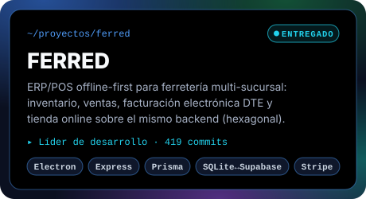
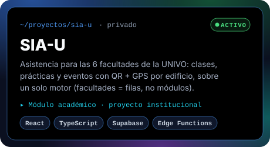
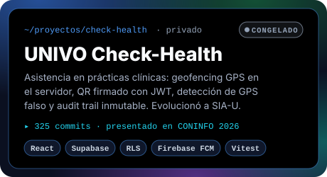
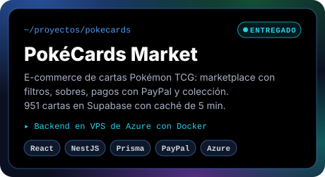
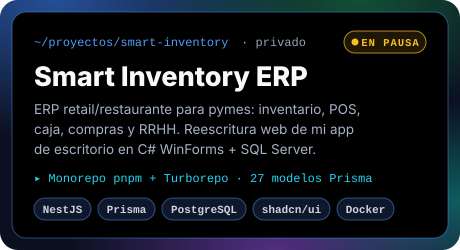
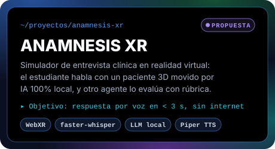
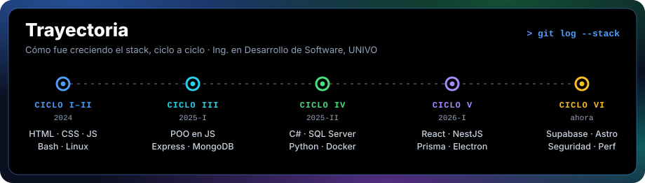
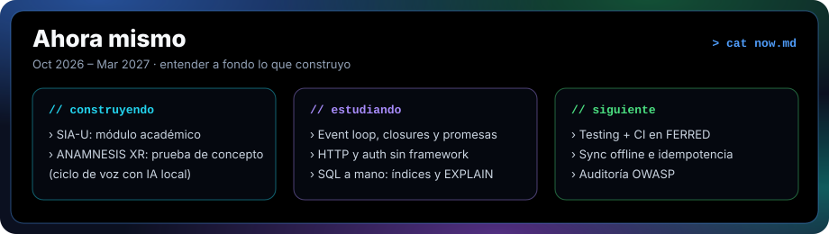

## `> whoami`

Estudiante de **Ingeniería en Desarrollo de Software** en la UNIVO (San Miguel, El Salvador), cursando el ciclo VI de 10. Construyo bajo la marca **Gnd-Code**.

- 🧱 Me gusta el software que resuelve problemas de verdad: **POS/ERP offline-first** para negocios que no pueden parar cuando se cae internet, y **sistemas de asistencia** que la universidad usa.
- 🛡️ Me importa que funcione en producción: RLS en Postgres, validación en el servidor, QR firmados, hardening de CORS/CSP, auditorías de seguridad.
- 👥 He liderado el desarrollo en equipo con **Scrum**: arquitectura, backend, deploy y QA.
- 🧠 Ahora mismo sigo un plan de 24 semanas para dominar los fundamentos detrás de lo que construyo (JS a fondo, HTTP, SQL, testing, arquitectura).

## `> ls ~/proyectos --destacados`

  
  

  
  

  
  

  <b>Demos:</b>
  <a href="https://ferred.netlify.app">FERRED</a> ·
  <a href="https://pokecardsmarket.netlify.app">PokéCards Market</a>

## `> ls ~/lab`

| Proyecto | Qué es | Stack |
|---|---|---|
| [AstroBitácora](https://github.com/Carlos-Gnd/astro-performance-lab) · [demo](https://astro-lap-practice.vercel.app) | Laboratorio de rendimiento web medido con Lighthouse | Astro |
| [App To-Do](https://github.com/Carlos-Gnd/App-TO-DO) · [demo](https://app-to-do-sepia.vercel.app) | To-do full-stack | Express · Prisma · MySQL · Docker |
| [Pokédex](https://github.com/Carlos-Gnd/pokedex) | Pokédex con PokéAPI | React 19 · TypeScript |
| [Smart Inventory Desktop](https://github.com/Carlos-Gnd/smart_inventoryProyect) | Inventario y ventas de escritorio | C# WinForms · SQL Server |
| [Conecta Tu Mente](https://github.com/Carlos-Gnd/Conecta-Tu-Mente) | Landing bilingüe enfocada en rendimiento y SEO; el formulario escribe a Supabase con RLS solo-INSERT y rate limit por trigger | HTML/CSS/JS · Supabase |
| [Prácticas EDD](https://github.com/Carlos-Gnd/Practicas-EDD) | Laboratorios de estructuras de datos | Python |
| [autodns](https://github.com/Carlos-Gnd/script_ubuntu_server) | IP estática + DNS automático en Ubuntu Server | Bash |
| [Login Ubuntu Server](https://github.com/Carlos-Gnd/Login-Ubuntu-server) | Login en contenedores | Nginx · PHP · MySQL · Docker |

## `> cat stack.yml`

<table>
  <tr>
    <td width="150"><b>Lenguajes</b></td>
    <td></td>
  </tr>
  <tr>
    <td><b>Frontend</b></td>
    <td></td>
  </tr>
  <tr>
    <td><b>Backend y datos</b></td>
    <td></td>
  </tr>
  <tr>
    <td><b>Infra y tooling</b></td>
    <td></td>
  </tr>
</table>

## `> git log --stack`

## `> ./profile-scan --live`

Hecho en San Miguel, El Salvador 🇸🇻 · <b>Gnd-Code</b>

